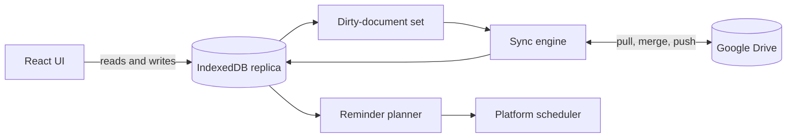

# Kavanu — Architecture Document

Cross-platform study tracking and scheduling, with **no backend**: every byte of user data lives in the user's own Google Drive, and each client is a local-first replica of it.

Status: proposal · Rollout: Web → Android → Desktop

---

## 0. Summary of decisions

| Area | Decision |
|---|---|
| UI stack | React + TypeScript + Vite, shipped as an installable PWA |
| Android | Capacitor shell around the same web bundle |
| Desktop | Tauri v2 shell around the same web bundle |
| Local store | IndexedDB (via Dexie) on every platform; it is the source of truth for the UI |
| Remote store | JSON documents in Google Drive, sharded by concern and by year |
| Drive location | **Hybrid**: `appDataFolder` for private data, one visible file per study group |
| OAuth scopes | `drive.appdata` + `drive.file` only (both non-sensitive, so no security assessment) |
| Sync | State-based CRDT documents (per-record last-writer-wins with hybrid logical clocks), read–merge–write |
| Reminders | A shared pure "reminder planner" plus per-platform schedulers; optional Google Calendar mirror for reliable web reminders |
| Groups | One Drive file per group, shared by email through Drive permissions, holding a per-member *projection* of progress |

The three constraints that shape everything else:

1. **Drive is a file store, not a database.** There are no transactions, no queries, and (in API v3) no conditional writes. The data model must therefore converge under blind concurrent overwrites.
2. **A browser cannot hold a long-lived Google credential without a server.** Web sync only happens while the user is present.
3. **A browser cannot fire a notification at a future time while closed** without a push server. Web reminders are best-effort unless delegated to another Google service.

---

## 1. Tech stack

### 1.1 Recommendation

```
packages/
  core/        Pure TypeScript, no DOM, no platform APIs
               - domain model, schedule engine, link resolver
               - CRDT merge, sync engine, reminder planner
               - ports (interfaces): AuthPort, DrivePort, LocalStorePort,
                 NotificationPort, SecretStorePort, ClockPort
  ui/          React components, routing, state, i18n (RTL-first)
apps/
  web/         Vite + PWA plugin (Workbox service worker), web adapters
  android/     Capacitor project, native adapters
  desktop/     Tauri v2 project, native adapters
```

- **React + TypeScript + Vite.** Largest ecosystem, first-class PWA tooling, and Google's browser libraries (Identity Services, Picker) are JavaScript-native.
- **Capacitor for Android.** Reuses the web bundle unchanged and gives mature plugins for the two things the web cannot do: exact local notifications and native Google authorization.
- **Tauri v2 for desktop.** Small binaries, system-browser OAuth, OS keychain, tray and autostart. Electron is the fallback if a needed plugin is missing.
- **Hexagonal (ports and adapters) layout.** `core` and `ui` are roughly 90% of the code and are identical on all three platforms; each app supplies only adapters.

### 1.2 Alternatives considered

| Option | Why not |
|---|---|
| Flutter | Web output is canvas-rendered: heavier, weaker accessibility and text handling (matters for Hebrew/RTL), and Google's web auth and Picker need JS interop anyway. Strong choice only if mobile were first. |
| React Native + RN Web | Optimises for native feel at the cost of the web build, which is phase 1. Desktop story is weakest. |
| PWA only (TWA on Android) | Cannot schedule exact alarms or hold refresh tokens, which defeats the reason for phases 2 and 3. |

### 1.3 Supporting libraries

- `@hebcal/core` and `@hebcal/learning` for the Hebrew calendar and fixed cycles (Daf Yomi, Mishna Yomi and similar), so those schedules are computed, not stored.
- Dexie for IndexedDB; Zod for validating every document read from Drive (Drive content is untrusted input).
- Static hosting only (for example GitHub Pages or Cloudflare Pages). A static host serves the app shell and the built-in curriculum catalog; it never sees user data.

---

## 2. Google Drive storage strategy

### 2.1 Format: sharded JSON documents

SQLite-over-Drive is rejected: the file is an opaque binary that must be re-uploaded whole and cannot be merged, so two devices writing concurrently means one loses everything. JSON documents designed for merging do not have that problem.

A single JSON blob is also rejected: it grows without bound and makes every checkbox a full rewrite. Documents are split so that each one is small, changes at a different rate, and has a clear merge rule.

```
appDataFolder/                        (hidden, scope drive.appdata)
  manifest.json                       schema version, device registry, file index
  settings.json                       preferences, reminder rules
  tracks.json                         all StudyTrack definitions
  progress-2026.json                  one shard per calendar year
  progress-2027.json
  groups.json                         memberships: group file ids, shared-track choices

My Drive/Kavanu/                      (visible, scope drive.file)
  group-<groupId>.json                one file per group the user OWNS
  exports/                            optional user-initiated backups
```

A year of progress for ten daily tracks is a few thousand small records, on the order of 100 KB, well inside a single simple upload.

### 2.2 AppData versus visible folder

| | `appDataFolder` | Visible folder |
|---|---|---|
| User can corrupt or move files | No | Yes |
| Can be shared with other users | **No** | Yes |
| User can inspect or back up | No (only "delete hidden app data") | Yes |
| Scope | `drive.appdata` | `drive.file` |

Recommendation: **hybrid**. Private state goes in `appDataFolder`, where it is safe from accidental edits. Group files must be shareable, so they live in a visible `Kavanu/` folder. An in-app "Export my data" action writes a readable copy to `Kavanu/exports/` to compensate for the hidden folder's opacity.

Both scopes are non-sensitive, which keeps Google's app verification to basic brand verification. Any broader Drive scope (`drive`, `drive.readonly`) is restricted and triggers an annual third-party security assessment; the design avoids it deliberately, and section 5 shows the price paid for that.

### 2.3 OAuth 2.0 without a backend

One Google Cloud project, three OAuth client IDs (one per platform type), same scopes.

| Platform | Flow | Token lifetime and storage |
|---|---|---|
| Web | Google Identity Services **token model** (popup, access token returned to the page) | Access token only, about 1 hour, held in memory. No refresh token is available to a browser-only app, because Google's web client type requires a client secret for the code exchange. |
| Android | Native Google authorization (Credential Manager for sign-in, `AuthorizationClient` for Drive scopes), client bound to package name and signing certificate | The OS account manager silently mints fresh access tokens, so background sync works. |
| Desktop | Authorization code + **PKCE** in the system browser with a loopback redirect (`http://127.0.0.1:<random port>`) | Refresh token stored in the OS keychain (Keychain, Credential Manager, libsecret). The "desktop" client secret is not confidential and is treated as public. |

Consequences to design around:

- **Web sessions expire hourly.** The client requests a new token silently when the user still has a Google session and prior consent; otherwise it shows a "Reconnect" affordance. The app must stay fully usable offline in the meantime, with changes queued locally.
- **Never embed a web view for sign-in** on Android or desktop; Google blocks it. Use the native API or the system browser.
- **Publish the OAuth consent screen to production** before real use; in testing mode, refresh tokens expire after seven days.
- `AuthPort` exposes one method, `getAccessToken(scopes, { interactive })`, hiding all of the above from `core`.

---

## 3. Synchronization and conflict resolution

### 3.1 Local-first shape



The UI only ever talks to the local replica, so every interaction is instant and works offline. The sync engine is a background reconciler between the local replica and Drive.

### 3.2 Why not optimistic locking

The obvious approach, "upload only if the file has not changed since I read it", is not available: Drive API v3 does not offer conditional (`If-Match`) updates on file content. A read-check-write sequence always has a race window. The architecture therefore assumes **any write may silently overwrite a concurrent write** and makes that harmless.

### 3.3 Documents as state-based CRDTs

Every synced document is a map of records. Every record carries a **hybrid logical clock** stamp (`hlc`: wall-clock milliseconds, a logical counter, and the device id as a tiebreaker).

- **Merge rule:** for each record key, keep the record with the greater `hlc`. Merge is commutative, associative and idempotent, so replicas converge regardless of order or repetition.
- **Granularity:** one record per `(trackId, date)` for progress; one record per track; one record per setting key. Two devices ticking *different* days never conflict at all. Two devices changing the *same* checkbox resolve to the later action, which is the intuitive result.
- **Deletes are tombstones** (`deleted: true` with an `hlc`), never physical removal, otherwise a stale device would resurrect the record. Tombstones older than a retention horizon (for example 180 days) are compacted, and a device that has been offline longer than the horizon is forced to do a full re-download instead of a merge.
- **Hybrid logical clocks** rather than raw timestamps protect against a device with a wrong clock: each device advances its clock past the highest stamp it has seen.

### 3.4 Sync cycle

1. **Detect.** Call `changes.list` with the saved page token (or compare `version`/`md5Checksum` from one `files.list`) to find remote documents that changed.
2. **Pull and merge.** Download each changed document, validate it, merge it into the local replica.
3. **Push.** For each document where the merged state differs from what was downloaded, upload the merged state.
4. **Verify lazily.** If another device overwrote the upload in the race window, nothing is lost: this device still holds its records locally, sees the remote change on the next cycle, merges, notices the remote copy lacks its records, and pushes again. Lost updates are self-healing because **every replica keeps full state**.

Triggers: app start, regaining connectivity, tab becoming visible, a debounced few seconds after a local change (coalescing bursts of ticks into one upload), and a periodic timer. On Android, a WorkManager job runs the same cycle in the background; on desktop the tray process does. On web, sync runs only while the app is open and a token is valid.

### 3.5 Worked example: phone and laptop at once

Both devices are offline. The phone marks Monday done; the laptop marks Tuesday done and un-marks Sunday. Both come online and race.

- Laptop uploads `progress-2026.json` containing Tuesday and Sunday's change.
- Phone, which read the file before that upload, uploads its own version containing only Monday. The laptop's upload is overwritten.
- Laptop's next cycle sees a new remote version, merges (gaining Monday), sees that remote lacks Tuesday and Sunday's change, and uploads the union.
- Phone's next cycle pulls the union. Both replicas are identical.

### 3.6 Schema evolution

`manifest.json` holds `schemaVersion` and `minClientVersion`. A client older than `minClientVersion` goes read-only and asks the user to update, so an old build can never rewrite documents in a shape it does not understand. Migrations are pure functions in `core`, run by the first upgraded client.

---

## 4. Reminders without a server

### 4.1 Pattern: plan, then reconcile

`core` contains a pure function:

```
planReminders(tracks, progress, settings, now) -> DesiredNotification[]
```

It materialises a **rolling window** (for example the next 14 days) of concrete notifications, each with a stable id (`trackId + date + ruleId`), a fire time, a title that already names the day's material, and a deep link. Each platform's `NotificationPort` adapter diffs the desired set against what the OS currently has scheduled, then cancels and schedules the difference.

The planner re-runs after every local change and every sync. That is what makes reminders *smart*: marking today done on the laptop cancels tonight's nudge on the phone once the phone syncs.

### 4.2 Platform capabilities

| Platform | Mechanism | Reliability |
|---|---|---|
| Android | Capacitor Local Notifications over `AlarmManager` | High. Fires with the app closed. |
| Desktop | In-process scheduler in a tray process started at login | High while the user is logged in; missed reminders are shown on wake. |
| Web (PWA) | Timers while open; Periodic Background Sync when installed | **Low when closed.** See below. |

**Android details.** Request `POST_NOTIFICATIONS` at a meaningful moment (Android 13+). Exact timing needs the exact-alarm permission, which is denied by default on recent versions; fall back to inexact alarms (minutes of drift, acceptable for study reminders) if the user declines. Re-register all alarms on device boot and after app update. A periodic WorkManager job syncs with Drive and re-runs the planner so the window never runs dry even if the app is not opened for weeks.

**Desktop details.** The Tauri app registers for autostart and lives in the tray; closing the window does not quit the process. On resume from sleep it re-runs the planner and surfaces anything missed.

**Web: the honest limitation.** A service worker cannot wake itself at a chosen time. The API intended for that (Notification Triggers) was abandoned, Periodic Background Sync is Chromium-only with browser-controlled, imprecise intervals, and Web Push requires a server to send the push. So the web tier is layered:

1. **Foreground:** while a tab or the installed PWA is open, timers fire notifications through the service worker registration.
2. **Opportunistic:** Periodic Background Sync, where granted, shows a "you have study due today" notification on its own schedule.
3. **Recommended opt-in: Google Calendar mirror.** The client writes the reminder plan as events with notifications into a dedicated secondary calendar in the user's Google Calendar. Google then delivers reminders on every device the user owns, with the daily link in the event body. This stays within "no backend of ours" and keeps data in the user's Google account, but it needs one extra Calendar scope and stores a derived copy outside Drive, so it is a product decision to confirm rather than a default.
4. **Fallback:** export an `.ics` file for any calendar app.

Onboarding on web should state plainly that dependable reminders come from installing the Android or desktop app or enabling the calendar mirror.

---

## 5. Study groups on Drive alone

### 5.1 The constraint that drives the design

With the `drive.file` scope, the app can only touch files it created **for this user**, or files this user explicitly opened with the app through the Google Picker. A file that another member created is invisible to the app until the user picks it, and picking a folder does not reliably extend access to files other people add to it later. The naive design, "a shared folder where each member writes their own file", therefore fails: every member would need to re-pick every other member's file.

The design that works needs **exactly one explicit grant per group**.

### 5.2 Model: one shared file per group, holding projections

```
group-<id>.json   owned by the group creator, in their visible Kavanu/ folder
  meta            name, shared track template, createdBy
  members{}       one section per member, keyed by a member id
    profile       display name
    summary       streak, completion counts
    recent{}      per-day completion for a bounded window (for example 90 days)
```

- **Membership is Drive's access control list.** The owner invites by email with `permissions.create` (`type: user`, `role: writer`). No link sharing, so the file is never reachable by someone who merely learns its id.
- **Joining.** The invite is an app link carrying the file id (`/join#file=<id>`). The app opens the Picker pre-targeted at that id; the user's confirmation grants the app access to that single file. The client then writes its own member section.
- **The group file is a projection, not a source of truth.** Each member's canonical progress stays in their private `appDataFolder`. Their client derives its section from that and republishes it during sync. If the section is lost in a write race, or damaged, it is regenerated on that member's next sync.
- **Same merge rule as everywhere else.** Each member section carries an `hlc`; merge is per-section last-writer-wins. Since in normal operation only one user writes a given section, contention is limited to the whole-file overwrite race, which self-heals as in section 3.4.
- **Privacy is opt-in and minimal.** A member publishes only the tracks they chose to share with that group, and only done/not-done per day. Nothing else leaves the private store.
- **Leaving and removal.** A member's client deletes its section and removes its own permission. The owner can remove a member with `permissions.delete`, which revokes access immediately.

### 5.3 Security analysis

| Concern | Position |
|---|---|
| Outsiders reading group data | Prevented by Drive permissions (named accounts only). |
| A member reading another member's private data | Impossible; private data is in a per-user hidden folder that cannot be shared. |
| A member tampering with another member's section | **Possible in the base design**, because Drive permissions are per file, not per section. Impact is limited to a low-stakes display, is visible in Drive revision history, and is undone by the victim's next sync. |
| Members seeing each other's email addresses | Inherent to Drive sharing. Disclose this on the join screen. |
| Owner deletes the file or leaves | The group ends. Mitigation: ownership transfer through Drive, or any member "re-founds" the group from their cached copy. |

**Hardening option (later phase): signed sections.** Each member generates a signing key pair; the private key stays in their `appDataFolder`, the public key is recorded in the group file on first join. Every section is signed and clients ignore sections that fail verification. This gives tamper *detection* without a server. It is deferred because the data is low-stakes and the scheme adds key management.

### 5.4 Alternative considered

Per-member files shared as "anyone with the link, read-only", encrypted with a group key carried in the invite link, and read with an API key. This gives true per-member write integrity, but joining needs a two-way handshake (the owner must learn each new file id), many organisations disable link sharing, and it expands the trust surface to link secrecy. Rejected for the first version.

### 5.5 Limits

Suitable for small groups (a chavruta, a class, a few dozen people). All members rewrite one file, so write contention grows with size; cap membership (for example 50) and keep the per-member window bounded.

---

## 6. Data models

Common conventions: ids are client-generated UUIDs; `hlc` is a sortable string `"<ms>-<counter>-<deviceId>"`; dates are local calendar dates (`YYYY-MM-DD`) because "did I study on Tuesday" is a calendar question, not an instant; every document has `schemaVersion`.

### 6.1 `manifest.json`

```json
{
  "schemaVersion": 1,
  "minClientVersion": "1.0.0",
  "user": { "id": "u_7f3a", "displayName": "Dana", "createdAt": "2026-11-11T08:00:00Z" },
  "devices": {
    "d_web_91c": { "platform": "web", "label": "Chrome on laptop", "lastSyncAt": "2026-11-11T09:12:00Z" },
    "d_and_22e": { "platform": "android", "label": "Pixel", "lastSyncAt": "2026-11-11T07:40:00Z" }
  },
  "tombstoneHorizonDays": 180
}
```

### 6.2 `settings.json` (each key is its own last-writer-wins record)

```json
{
  "schemaVersion": 1,
  "records": {
    "locale":        { "value": "he", "hlc": "1794384000000-0-d_web_91c" },
    "timezone":      { "value": "Asia/Jerusalem", "hlc": "1794384000000-1-d_web_91c" },
    "weekStartsOn":  { "value": 0, "hlc": "1794384000000-2-d_web_91c" },
    "calendarMirror":{ "value": { "enabled": false }, "hlc": "1794384000000-3-d_web_91c" }
  }
}
```

### 6.3 `tracks.json` — StudyTrack

```json
{
  "schemaVersion": 1,
  "records": {
    "t_dafyomi": {
      "id": "t_dafyomi",
      "title": "Daf Yomi",
      "color": "#3b6fd4",
      "schedule": {
        "kind": "fixedCycle",
        "cycle": "dafYomi"
      },
      "link": { "provider": "sefaria" },
      "reminders": [
        { "id": "r1", "time": "06:30", "onlyIfNotDone": false },
        { "id": "r2", "time": "21:00", "onlyIfNotDone": true }
      ],
      "archived": false,
      "deleted": false,
      "hlc": "1794384100000-0-d_web_91c"
    },
    "t_mishnah": {
      "id": "t_mishnah",
      "title": "2 Mishnayot a day",
      "schedule": {
        "kind": "sequential",
        "curriculum": "mishnah",
        "startDate": "2026-11-01",
        "startUnit": "Berakhot 1:1",
        "unitsPerSession": 2,
        "recurrence": { "type": "daily" },
        "pacing": "fixed"
      },
      "link": { "provider": "sefaria" },
      "reminders": [],
      "deleted": false,
      "hlc": "1794384200000-0-d_web_91c"
    },
    "t_history": {
      "id": "t_history",
      "title": "History",
      "schedule": {
        "kind": "freeform",
        "recurrence": { "type": "weekly", "daysOfWeek": [0, 2, 4] }
      },
      "link": { "provider": "template", "urlTemplate": "https://example.org/course/lesson/{sessionIndex}" },
      "reminders": [{ "id": "r1", "time": "17:00", "onlyIfNotDone": true }],
      "deleted": false,
      "hlc": "1794384300000-0-d_and_22e"
    }
  }
}
```

Three schedule kinds cover the requirements:

- `fixedCycle`: the unit for a date is a pure function of the date (Daf Yomi and similar world-wide cycles). Nothing is stored.
- `sequential`: walks an ordered curriculum from a start point at N units per session. `pacing: "fixed"` keeps the calendar moving when a day is missed; `"elastic"` makes the next session resume from the last completed unit.
- `freeform`: recurrence only, no curriculum (Science, History); sessions are numbered.

**Daily links** are resolved, never stored. The schedule engine yields a session descriptor (`date`, `sessionIndex`, `units`, a canonical `ref`), and a **link provider** turns it into a URL: built-in providers for known libraries (for example Sefaria references), or a user-supplied `urlTemplate` with placeholders (`{date}`, `{sessionIndex}`, `{ref}`, `{hebrewDate}`). Curricula (ordered unit lists) ship as static JSON with the app. On Android, links are fired as intents so an installed study app can claim them.

### 6.4 `progress-<year>.json` — Progress

```json
{
  "schemaVersion": 1,
  "year": 2026,
  "records": {
    "t_dafyomi|2026-11-10": { "done": true,  "doneAt": "2026-11-10T19:02:00Z", "hlc": "1794337320000-0-d_and_22e" },
    "t_dafyomi|2026-11-11": { "done": true,  "doneAt": "2026-11-11T05:48:00Z", "note": "Reviewed twice", "hlc": "1794376080000-0-d_and_22e" },
    "t_mishnah|2026-11-11": { "done": false, "hlc": "1794380000000-2-d_web_91c" }
  }
}
```

The key is `trackId|scheduledDate`. Un-checking writes `done: false` with a newer `hlc` rather than deleting, so the un-check itself survives merging. What was studied on that date is derived from the track definition, keeping records tiny.

### 6.5 `groups.json` (private) and `group-<id>.json` (shared)

```json
{
  "schemaVersion": 1,
  "records": {
    "g_41bd": {
      "driveFileId": "1AbC...",
      "role": "member",
      "memberId": "m_dana",
      "sharedTrackIds": ["t_dafyomi"],
      "left": false,
      "hlc": "1794384400000-0-d_web_91c"
    }
  }
}
```

```json
{
  "schemaVersion": 1,
  "meta": {
    "id": "g_41bd",
    "name": "Morning Daf",
    "trackTemplate": { "title": "Daf Yomi", "schedule": { "kind": "fixedCycle", "cycle": "dafYomi" } },
    "hlc": "1794300000000-0-d_x"
  },
  "members": {
    "m_dana": {
      "displayName": "Dana",
      "summary": { "currentStreak": 12, "doneLast30": 27 },
      "recent": { "2026-11-09": true, "2026-11-10": true, "2026-11-11": true },
      "left": false,
      "hlc": "1794376090000-0-d_and_22e"
    }
  }
}
```

---

## 7. Cross-cutting concerns

- **Untrusted input.** Every document from Drive is schema-validated before merging. A document that fails validation is quarantined (kept, not overwritten) and the user is offered a restore from Drive revision history.
- **Token hygiene.** Web: access token in memory only, strict Content Security Policy, no third-party scripts beyond Google's. Native: secrets only in the OS keystore.
- **Quota.** Debounced, coalesced uploads and change-token polling keep usage far below Drive's per-user limits; back off exponentially on `403`/`429`.
- **Account switch.** The local replica is namespaced by Google account id so signing in as someone else never merges two people's data.
- **Disconnect and delete.** "Delete all my data" removes the `appDataFolder` files, the user's sections in group files, and the local replica.

---

## 8. Risks to prototype before committing

1. **Picker-based join on Android.** The Picker is a web component; confirm it works inside the Capacitor web view with a natively obtained token, or fall back to completing the join step in a browser tab.
2. **Silent token renewal on web.** Measure how often the hourly renewal needs a visible prompt across browsers with third-party-cookie restrictions; this determines how intrusive web sync feels.
3. **Group file contention.** Simulate 30–50 members syncing in the same minute and confirm sections converge within a few cycles.
4. **Exact-alarm permission and vendor battery policies** on real Android devices from several manufacturers.
5. **Calendar mirror scope.** Confirm the narrowest Calendar scope that allows an app-owned secondary calendar and what verification tier it implies.

## 9. Phasing

| Phase | Scope |
|---|---|
| 1a | Web PWA: tracks, calendar, check-off, daily links, local-only storage |
| 1b | Drive sync (`appDataFolder`), multi-device merge, foreground reminders |
| 1c | Groups (shared file, Picker join), optional calendar mirror |
| 2 | Android shell: native auth, exact reminders, background sync |
| 3 | Desktop shell: PKCE auth, tray scheduler, autostart |
| Later | Signed group sections, elastic pacing refinements, more link providers |
