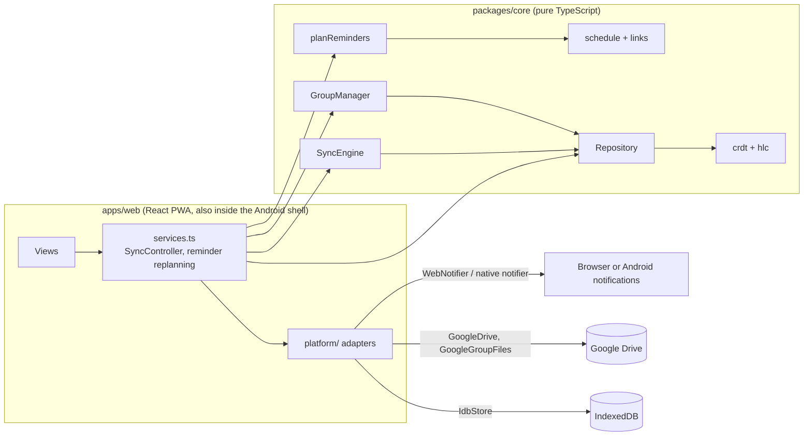
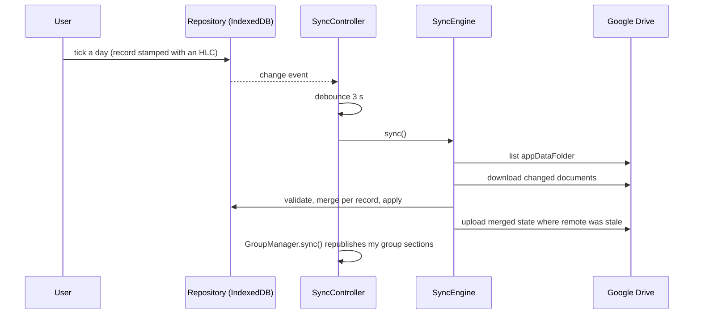

# High-level design

What Az Kavanu is built as today. [`ARCHITECTURE.md`](ARCHITECTURE.md) is the original design
proposal and the reasoning behind each choice (why Drive, why CRDTs, why one file per group);
this document describes what the code does now and points there for the "why". For which file
to open, see [`STRUCTURE.md`](STRUCTURE.md); for per-module contracts, see [`LLD.md`](LLD.md).

## Requirements

**Functional**

- Study tracks: about 20 fixed cycles (Daf Yomi, Mishna Yomi, Rambam, 929 and others) and the
  weekly parasha, Talmud or Mishnah at your own pace, numbered units, or plain counted sessions.
- Schedules on weekdays, days of the month (Gregorian or Hebrew), or N times per week or month.
- A calendar with per-day check-off, holidays and streaks; daily links (Sefaria built in, Shas
  Radar and Ot va-Ot for the studies they cover, URL templates otherwise), and a link of your own
  for any one day.
- Reminders, in the app or as a downloaded calendar file; adding a study to your own calendar
  (a Google Calendar link or an `.ics` file).
- Optional sync between the user's devices through their Google Drive.
- Study groups: one shared Drive file per group, invitations by email, a seven-day view of
  each member's progress.
- English and Hebrew (right-to-left).

**Non-functional**

- No backend: no server, database or analytics of ours ever holds user data.
- Works offline; the UI never waits on the network.
- Only non-sensitive Google scopes (`drive.appdata`, `drive.file`).
- Two devices editing at the same time never lose a change.

## Components

| Component | Responsibility | Boundary |
|---|---|---|
| `packages/core` | Model and validation, schedules, links, merge, sync, groups, reminder planning | No DOM or platform API; talks to the outside only through `DrivePort`, `LocalStorePort` and `GroupFilePort` |
| `apps/web/src/services.ts` | Builds the object graph, decides when to sync and re-plan reminders | The one composition root |
| `apps/web/src/platform/` | Adapters: IndexedDB, Google sign-in, Drive REST, group files, Picker, notifications | The only code that calls browser, Google or Capacitor APIs |
| `apps/web/src/views/` | Tracks, Calendar, Groups and Settings screens | Read from `Repository`, write through its methods |
| `apps/web/android` | Capacitor shell around the same web build | Native notifications only; no Drive yet (below) |

## Data flow

The UI only reads and writes the local replica; syncing is a background reconciliation.

Sync also runs on start, on regaining connectivity, when the tab becomes visible, and every
five minutes. Reminders are re-planned (`planReminders`) after every change and hourly, and the
notifier makes what the platform has scheduled match the plan.

## Data storage

| Store | What | Notes |
|---|---|---|
| IndexedDB (`kavanu` database, `kv` store) | Every document, the dirty set, sync state, cached groups | The source of truth for the UI. Falls back to memory when IndexedDB is unavailable (private browsing) |
| Drive `appDataFolder` | `manifest`, `settings`, `tracks`, `groups`, `progress-<year>` as JSON | Hidden from the user; scope `drive.appdata` |
| Drive `Kavanu/` folder | `group-<id>.json`, one per group the user owns | Visible and shareable; scope `drive.file` |

There is no cache or blob store beyond these. Backup is the user's own Drive (with its revision
history); without Drive the data exists only on the device.

## Configuration

Build-time Vite variables (`apps/web/.env.example`), none of them secret:

| Variable | Purpose | When missing |
|---|---|---|
| `VITE_GOOGLE_CLIENT_ID` | OAuth Web client for sign-in and Drive | Local-only mode: no sync, no groups |
| `VITE_GOOGLE_API_KEY`, `VITE_GOOGLE_APP_ID` | Google Picker, for joining a group someone else created | Joining by link is unavailable |

CI and the Pages deploy read them from repository variables. Vercel (`vercel.json`) reads its
own project settings.

## Validation at the edge

Drive content is untrusted, including group files that other members write. Every document is
parsed with its Zod schema (`parseDoc`, `parseGroupDoc`) before merging. A document that fails
is reported in the sync result and left untouched. A document with a newer schema version than
the client knows raises `SchemaTooNewError`, so an old build never rewrites data it doesn't
understand.

## Platforms

| Platform | Status |
|---|---|
| Web PWA | Built: local storage, Drive sync, groups, reminders while open |
| Android (Capacitor) | Built, local-only: reminders fire while the app is closed. Drive sync is off because Google blocks its web sign-in inside a web view (`services.ts`) |
| Desktop | Not built |

## Testing

`packages/core/test` runs the engine against the in-memory doubles in `memory.ts`
(`MemoryStore`, `MemoryDrive`, `MemoryGroupFiles`), including concurrent devices syncing
through one fake Drive. The browser adapters have no tests yet, and no test runs against the
real Drive API.
